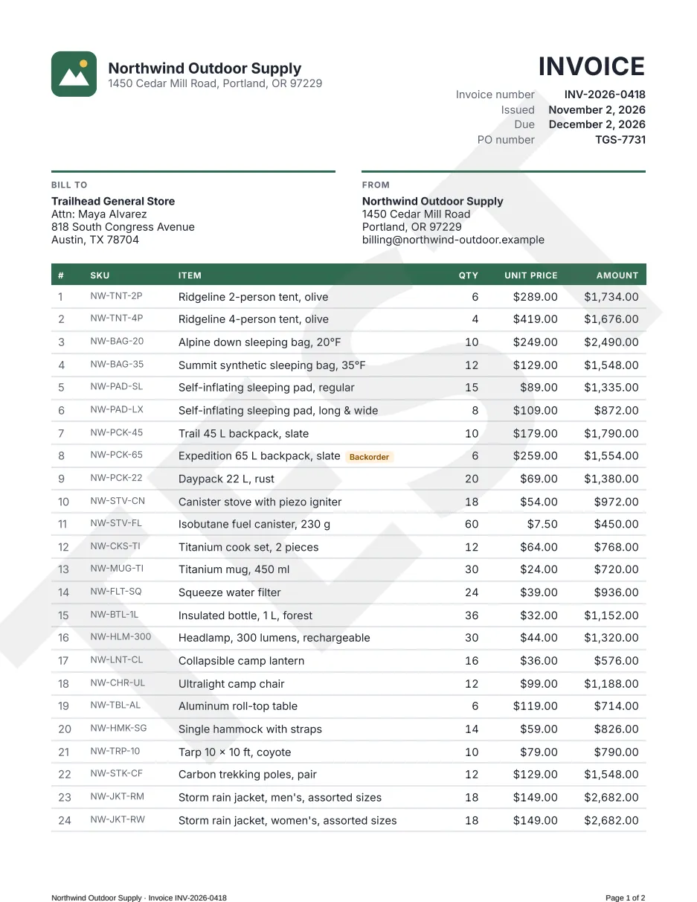
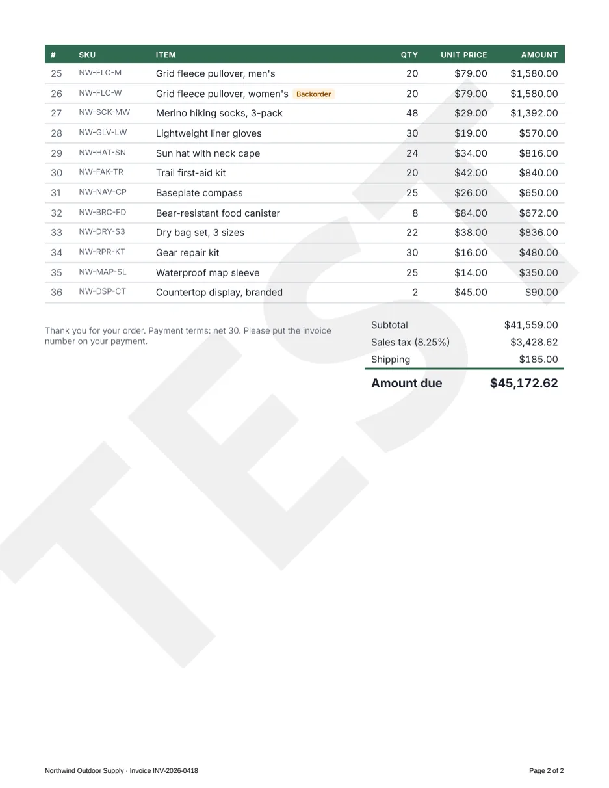
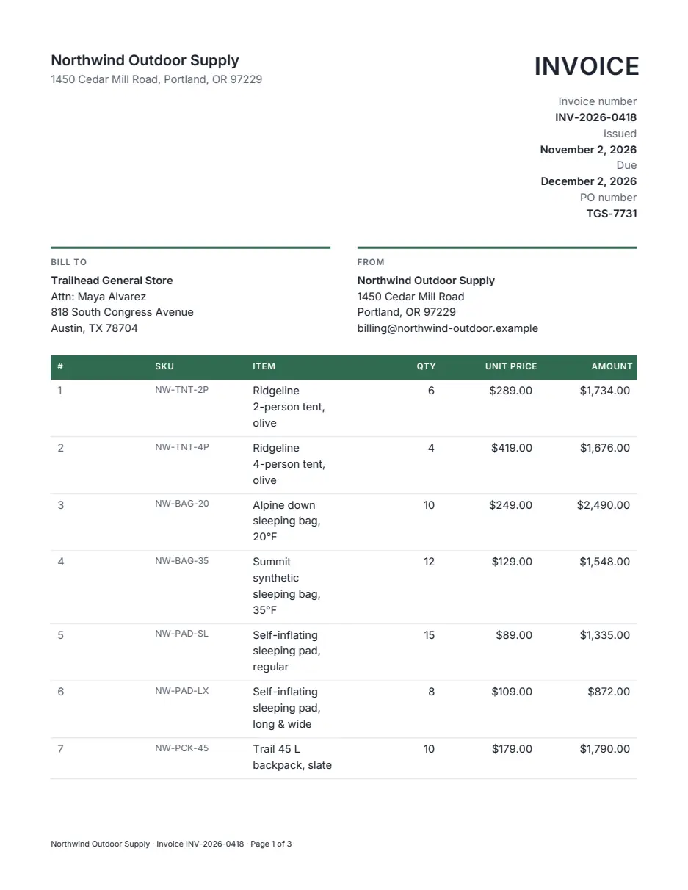
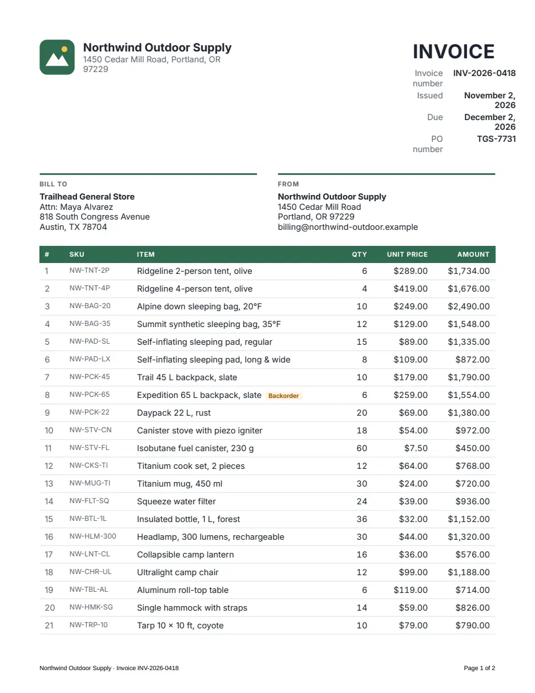
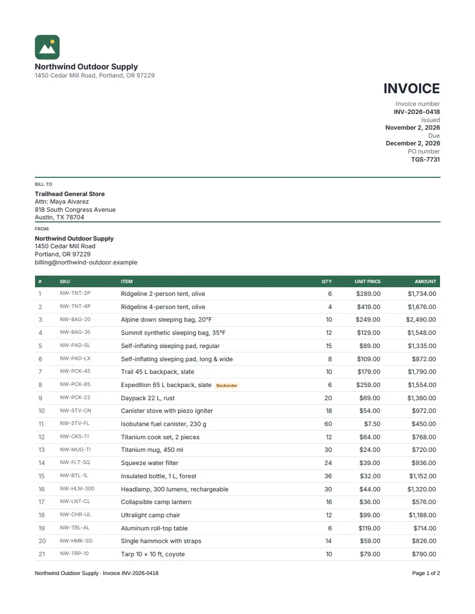
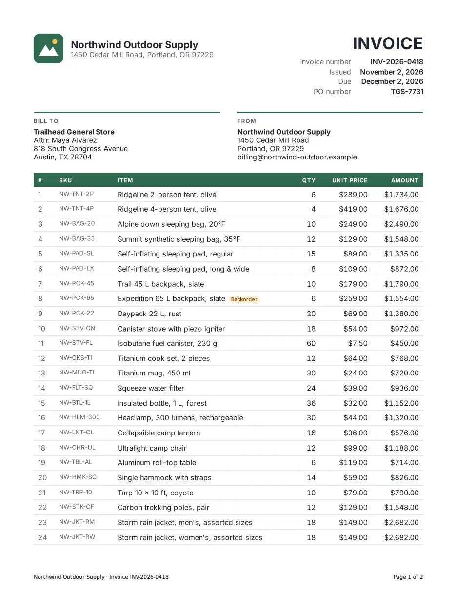

# HTML to PDF in Python: an invoice from a Jinja template

Render a two-page invoice from an HTML template and JSON data in Python with
[Dynamic Document API](https://dynamicdocumentapi.com/): a Flexbox header with an SVG logo, a web font, a line-item
table that repeats its header row on page 2, totals that stay together and "Page 1 of 2" in the footer.

| Page 1 | Page 2 |
|---|---|
|  |  |

The step-by-step tutorial: **[HTML to PDF in Python: an invoice from a Jinja template](https://dynamicdocumentapi.com/docs/tutorials/html-to-pdf-python)**.

## Run it

You need Python 3.9 or newer and an API key. Create one under **API keys** at
[app.dynamicdocumentapi.com](https://app.dynamicdocumentapi.com/signup) (free plan, no credit card). A test key
(`dda_test_…`) renders free PDFs with a TEST watermark.

```bash
python -m venv .venv && source .venv/bin/activate
pip install -r requirements.txt
export DYNAMIC_DOCUMENT_API_KEY="dda_test_..."

python render_invoice.py        # Python SDK -> invoice-INV-2026-0418.pdf
python render_requests.py       # plain requests, PDF in the response body -> invoice.pdf
python render_local_jinja.py    # fill the template with your own jinja2 first -> invoice-local.pdf
uvicorn app:app --reload        # FastAPI: http://127.0.0.1:8000/invoices/INV-2026-0418.pdf
```

[`docs/example-invoice.pdf`](docs/example-invoice.pdf) is the output of a test key.

## Files

| File | What it is |
|---|---|
| `invoice.html` | The template: HTML and CSS with Jinja placeholders, a loop over the line items, a condition and `"{:,.2f}".format()` for money. The same file works in Python's Jinja2 |
| `invoice.json` | An invented invoice with 36 line items |
| `invoice_data.py` | Loads the JSON and calculates line amounts, sales tax and totals with `Decimal` |
| `render_invoice.py` | Sends template, data and page settings with the Python SDK and downloads the PDF |
| `render_requests.py` | The same with `requests` and `"delivery": "binary"` |
| `render_local_jinja.py` | Fills the template with jinja2 locally and sends finished HTML with `templating=False` |
| `app.py` | A FastAPI route that returns the invoice PDF, with the async client |
| `compare/` | The same invoice through xhtml2pdf, WeasyPrint, pdfkit (wkhtmltopdf) and Playwright |

## Library comparison

[`compare/run_all.py`](compare/run_all.py) renders the invoice with four Python libraries, each with page numbers added
the way its documentation describes, and checks whether each one runs JavaScript. It runs in GitHub Actions on Debian 12
with Python 3.12 ([workflow](.github/workflows/compare.yml)); no API key needed. Results from the last run, with
versions, are in [`compare/results`](compare/results):

| Page 1 | |
|---|---|
|  xhtml2pdf 0.2.28: logo missing, details stacked, equal-width columns, 3 pages |  WeasyPrint 70.0: as designed, one narrow column wraps |
|  pdfkit 1.0 + wkhtmltopdf 0.12.6.1: Flexbox and grid ignored |  Playwright 1.65 (Chromium): as designed |

To run it yourself on Debian or Ubuntu: install `libpango-1.0-0 libpangoft2-1.0-0` and the
[wkhtmltopdf 0.12.6.1 package](https://github.com/wkhtmltopdf/packaging/releases/tag/0.12.6.1-3), then
`pip install -r compare/requirements.txt`, `python -m playwright install --with-deps chromium` and
`python compare/run_all.py`.

## Learn more

- [Template language](https://dynamicdocumentapi.com/docs/template-language): loops, conditions, filters for dates and money
- [PDF options](https://dynamicdocumentapi.com/docs/pdf-options): paper, margins, metadata, waiting for scripts
- [Headers and footers](https://dynamicdocumentapi.com/docs/headers-and-footers): text mode or your own HTML, page numbers
- [Python SDK](https://dynamicdocumentapi.com/docs/sdks-and-integrations#python)
- [HTML to PDF API](https://dynamicdocumentapi.com/html-to-pdf-api/)

## License

MIT. The invoice data is invented.
